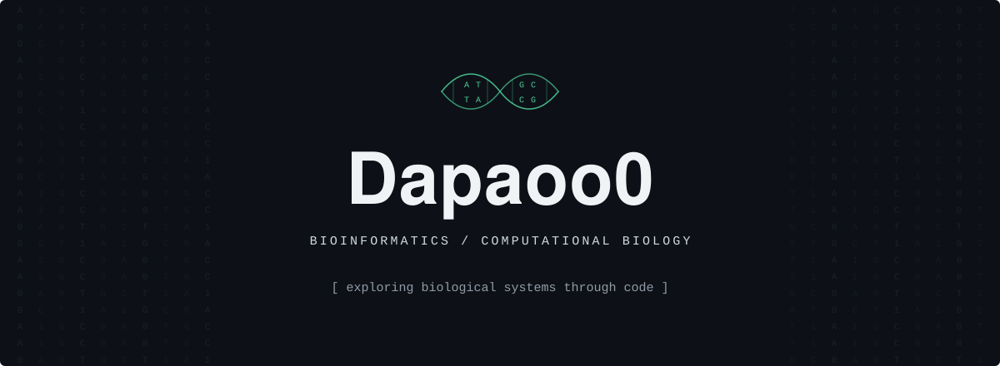

# Bioinformatics & Computational Biology

Dapaoo0 · Reproducible analysis, biological context, and careful model evaluation.

I explore biological questions through computational analysis, from protein variants and regulatory DNA to single-cell perturbations and tissue images. My projects focus on data provenance, group-aware validation, and understanding where predictive models succeed—and where their evidence stops.

## Selected projects

### [Protein Assay Context](https://github.com/Dapaoo0/protein-assay-context)

**Can a variant preserve measured protein abundance yet impair function?**
Paired deep mutational scanning assays, evaluated pretrained sequence scores, and separately tested learned sequence/structure models with residue-grouped nested validation. The conclusions remain specific to the measured assays, not clinical pathogenicity.

### [Regulatory Context Ceiling](https://github.com/Dapaoo0/regulatory-context-ceiling)

**What can local enhancer sequence reveal about biosample-specific chromatin states?**
Compared k-mers, motifs, pretrained DNA embeddings, and a compact CNN on SCREEN regulatory data with chromosome holdout. Distinguished sequence-only prediction from explanatory controls that use observed biological context.

### [Single-cell Perturbation Benchmark](https://github.com/Dapaoo0/single-cell-perturbation-benchmark)

**Can models predict unseen pairs of already-observed CRISPRa components?**
Built a reproducible CPU benchmark on processed K562 Perturb-seq data, using condition-level mean responses, additive and learned baselines, nested combination-level evaluation, and paired uncertainty. This tests unseen combinations, not unseen genes.

### [Morphomolecular Ambiguity](https://github.com/Dapaoo0/morphomolecular-ambiguity)

**How reliably do tissue-image representations transfer to spatial pathway scores?**
Compared frozen DINOv2 and Phikon-v2 encoders with slide-grouped modeling and cross-cancer validation. Examined retrospective morphology–molecular ambiguity and uncertainty without equating weak correlations with accurate molecular-state recovery.

## Methods and toolkit

- **Data:** assay harmonization, provenance tracking, reproducible preprocessing, and versioned artifacts.
- **Evaluation:** group-aware splits, nested validation, baseline comparisons, bootstrap uncertainty, and failure analysis.
- **Representations:** pretrained protein, DNA, and image models evaluated within explicit experimental limits.
- **Tools:** Python · NumPy · pandas · scikit-learn · PyTorch · Matplotlib.

[Explore all repositories →](https://github.com/Dapaoo0?tab=repositories)
